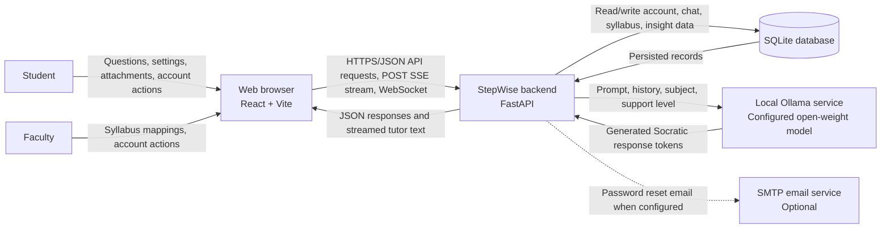
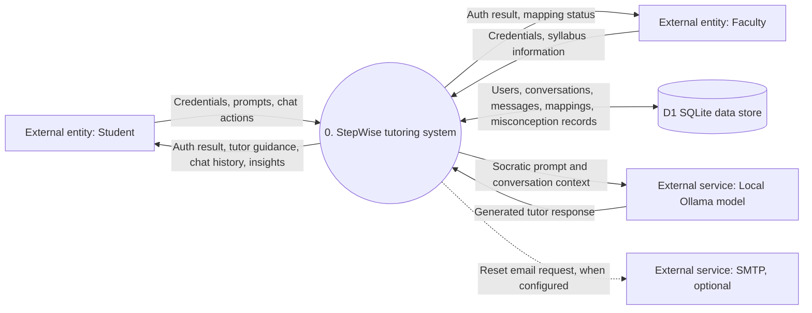
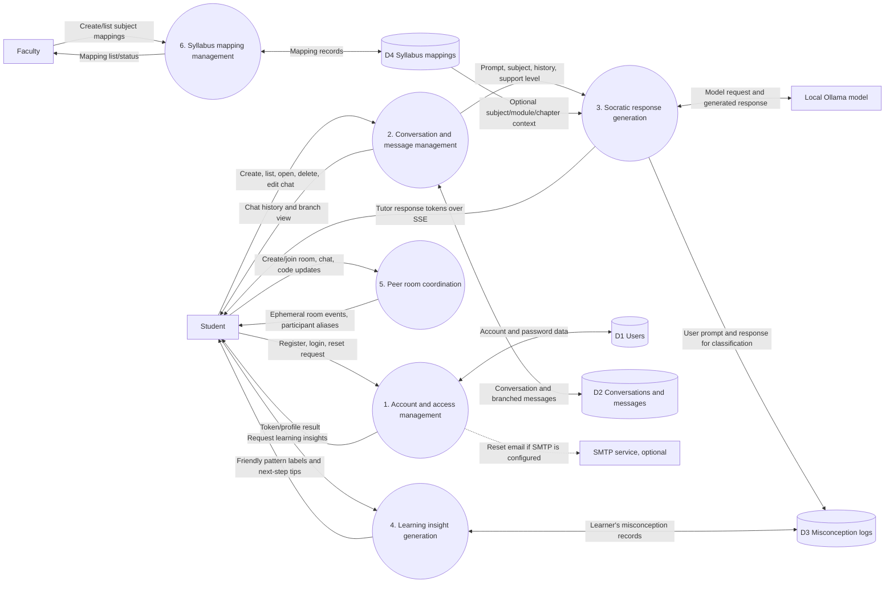
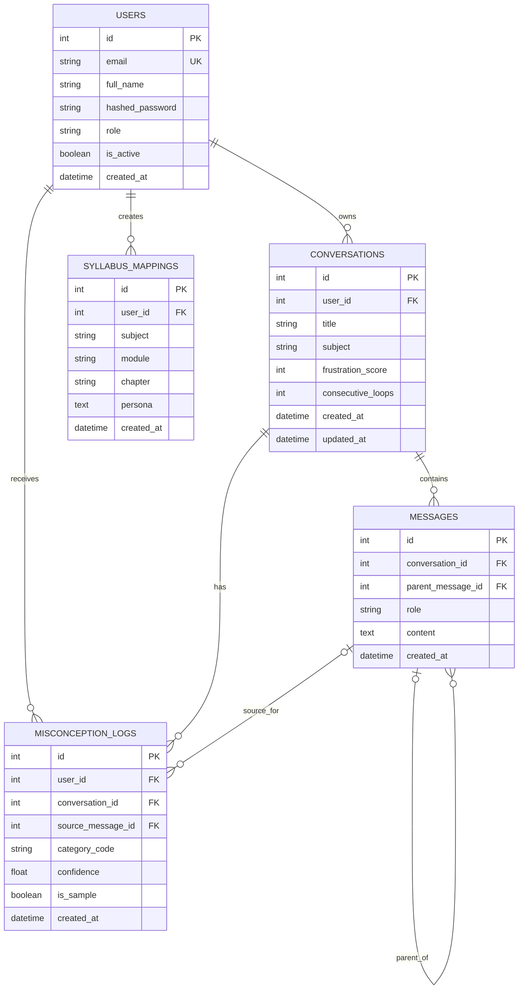
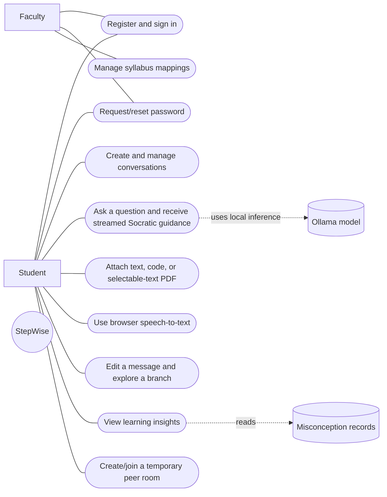
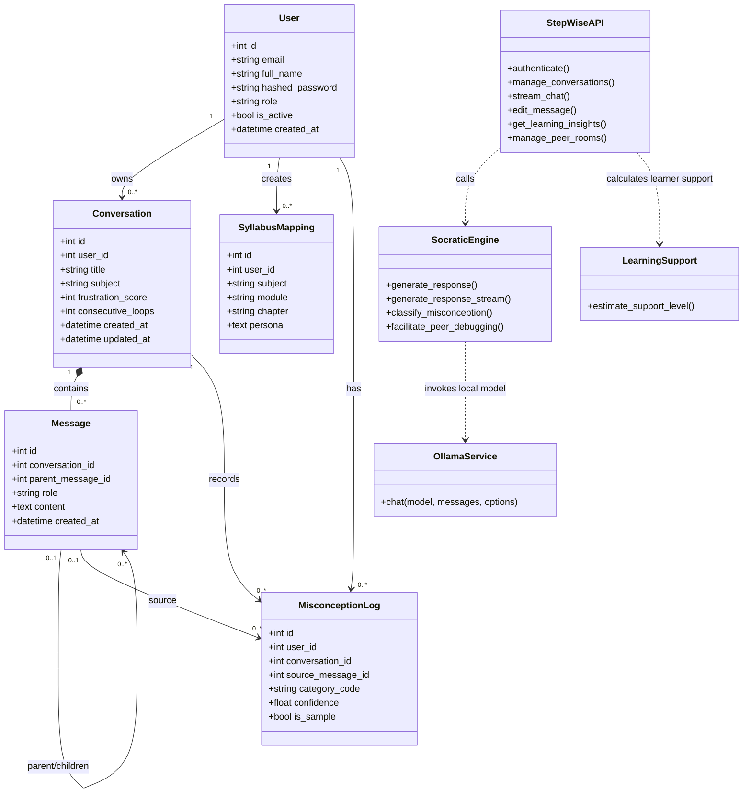
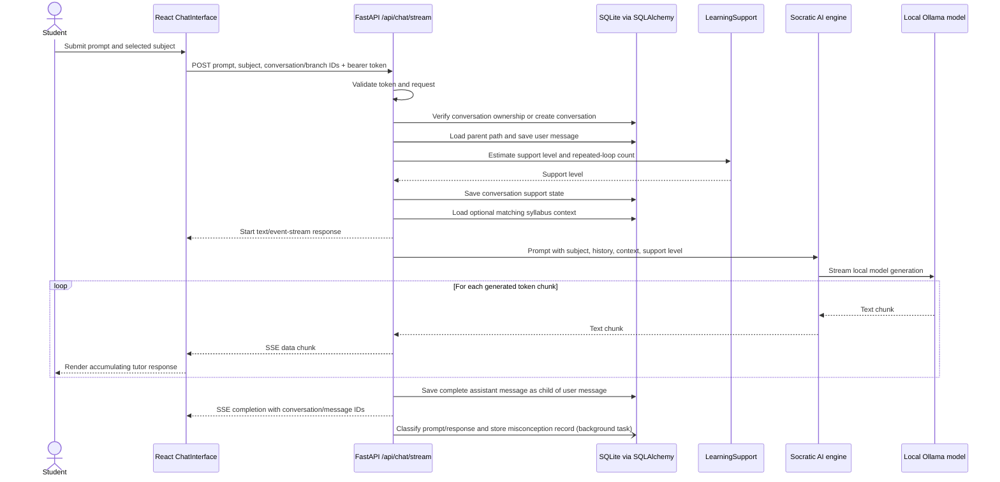

# StepWise Project Diagrams

**Project:** StepWise — An Interactive Local Socratic Tutoring System Powered by Large Language Models  
**Prepared for:** Project design and academic review  
**Status:** Diagrams reflect the current codebase inspected on 11 November 2026.

> These diagrams describe the current implementation. They are written in Mermaid, which can be rendered by GitHub, VS Code extensions, Mermaid Live, and many Markdown tools. Features explicitly marked as future scope are not shown as implemented.

## 1. System context diagram

This context diagram shows the system boundary and external actors/services.

## 2. Data Flow Diagram (DFD)

### DFD Level 0 — system overview

### DFD Level 1 — primary processes and data stores

**DFD data-store notes:** accounts, conversations, messages, syllabus mappings, and misconception logs are SQLAlchemy records stored in SQLite. Peer-room membership, code updates, and live messages are held in backend memory and expire; they are not persistent SQLite records. Attachment contents are extracted in the browser and included in the chat message text; the app has no separate file-storage data store.

## 3. Entity-Relationship Diagram (ERD)

This ERD follows the SQLAlchemy models in `models.py`. `PK` means primary key and `FK` means foreign key.

**Relationship notes:** A message's `parent_message_id` points to another message in the same message tree, allowing alternative branches. A misconception record's source message is optional (`SET NULL` on deletion); its user and conversation references are required. Deleting a user or conversation cascades through the relevant owned records as configured by the models/database.

## 4. UML Use-Case Diagram

## 5. UML Class Diagram

The domain portion models persisted entities. Service components are included to show the major runtime responsibilities.

## 6. UML Sequence Diagram — streamed tutoring exchange

## 7. Scope represented by these diagrams

**Implemented and shown:** authentication, SQLite persistence, conversation history and deletion, message branching/editing, streaming tutor chat, local Ollama inference, adaptive support/frustration tracking, misconception insights, faculty syllabus mappings, temporary two-person peer rooms, browser speech-to-text, and text/code/PDF attachment text extraction.

**Future scope (not shown as implemented):** curriculum RAG with ChromaDB, a knowledge graph, Docker code execution sandbox, Whisper.cpp local speech recognition, image/vision input, persistent multi-user collaboration, and faculty telemetry/analytics dashboard.

**Attachment and voice limits:** PDF extraction supports selectable text, not scanned image-only pages. Browser speech-to-text depends on browser and microphone support; it is not the planned local Whisper.cpp engine. Peer-room messages/code are temporary in-memory data.
